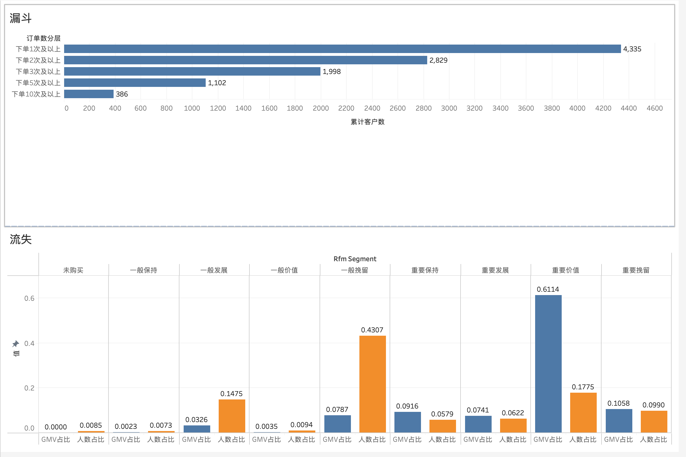

# 电商数据仓库 · 54 万行真实交易全链路（Hive）

基于 Hive 的 ODS → DWD → DWS → ADS 四层数仓，用 UCI Online Retail 真实数据集（541,909 行原始交易）跑通全链路，含数据质量校验、双路径对账、RFM 客户分群与 Tableau 看板。

**项目重点不是数据量，是每个数字都能解释。**

---

## 项目速览

| 项 | 值 |
|---|---|
| 原始交易行数 | 541,909 |
| DWD 去重后 | 536,641（删除完全重复 5,268 行，占 0.97%） |
| 订单数（全部，含取消单） | 25,900 |
| 订单数（正常单 · 商品行） | 20,538 |
| 客户数 | 4,372（另有匿名单 3,710 张） |
| 时间跨度 | 2010-12-01 ~ 2011-12-09（373 天） |
| 毛额 GMV（商品 · 正常单） | 10,247,219.32 |
| 净额 GMV（含取消冲销 -475,901.16） | 9,771,318.16 |
| 客户层 GMV（排除匿名） | 毛额 8,737,227.64 / 净额 8,265,476.93 |

---

## 一、为什么选这份数据

UCI Online Retail 是真实电商交易记录，脏得很典型。**清洗它的过程本身就是项目价值**：

| 问题 | 规模 | 不处理的后果 |
|---|---|---|
| `CustomerID` 缺失 | 135,080 行（**24.93%**） | `value_counts()` 默认隐藏缺失，会以为没问题 |
| `StockCode` 大小写重复 | **112 个编码**，1,977 行 | `85123A`(2,301) 与 `85123a`(67) 是同一商品，Top-N 榜错位 |
| 整行完全重复 | 5,268 行 | 所有 count 指标偏大 |
| `Description` 前后空格 | 112,371 行 | 同一商品名被分成两类 |
| `Country` 多种写法 | `EIRE` 8,184 行 | 爱尔兰被拆成两行 |
| CSV 带 UTF-8 BOM | 文件头 3 字节 | Hive 列名变 `\ufeffinvoice_no`，SQL **静默查空** |
| `CustomerID` 是 float | 显示 `17850.0` | 同一客户被拆成两个 |

第三类是**最阴的**：金额一分不差，但分组全错。所以清洗的目标不是"金额对"，是"维度对"。

---

## 二、四层架构

| 层 | 库 | 职责 | 关键动作 |
|---|---|---|---|
| **ODS** | `ods` | 原始贴源 | `OpenCSVSerde` 全字段读成 string，不做任何清洗 |
| **DWD** | `dwd` | 明细事实 | 去重、类型转换、**布尔标记分类**、行金额派生 |
| **DWS** | `dws` | 实体预聚合 | 日 / 客户 / 商品 / 国家 四个粒度 |
| **ADS** | `ads` | 应用指标 | RFM 客户分群 |

**核心原则**：一层一个库；上游洗过下游直接用（清洗逻辑只写一遍）；结果表一律 `INSERT OVERWRITE`（幂等）。

---

## 三、数据模型

| 表 | 粒度 | 行数 | 说明 |
|---|---|---|---|
| `ods.ods_retail_raw` | 一行 = 一条原始交易明细 | 541,909 | 外部表，全 string |
| `dwd.dwd_retail_detail` | 一行 = 一条去重后明细（含布尔标记） | 536,641 | ORC，下游唯一数据源 |
| `dws.dws_sales_daily` | 一天（有销售的日期） | — | 日 GMV + 订单/客户/件数 |
| `dws.dws_customer` | 一个客户 | 4,372 | 首末单、订单数、累计 GMV |
| `dws.dws_product` | 一个动销商品 | 3,816 | 首末售出、销量、销售额 |
| `dws.dws_country` | 一个国家 | 38 | 订单数、客户数、GMV |
| `ads.ads_customer_rfm` | 一个客户 | 4,372 | R/F/M 打分 + 九宫格分群 |

---

## 四、五个关键技术决策

### 1. 清洗不删行，用布尔标记落地分类

DWD 层不删除任何一行，而是把判断结果写成 6 个布尔列：

```sql
t.invoice_no like 'C%'                                    as is_cancel
t.stock_code = 'B'                                        as is_bad
(t.quantity < 0 and t.invoice_no not like 'C%')           as is_stock_record
(t.quantity >= 0 and t.invoice_no not like 'C%'
                  and t.stock_code <> 'B')                as is_formal
(t.stock_code in ('POST','DOT','M','C2','D','S',
                  'BANK CHARGES','AMAZONFEE','CRUK','B')
 or t.stock_code like 'GIFT_0001_%')                      as is_non_product
```

**为什么**：删了就再也查不回原始分布；标记留着，任何口径都能用 `WHERE` 重新组合。四类单据的交叉验证结果零矛盾：

| 类型 | 行数 |
|---|---|
| 正常单 `is_formal` | 526,051 |
| 取消单 `is_cancel` | 9,251 |
| 库存记录 `is_stock_record` | 1,336 |
| 坏账 `is_bad` | 3 |
| **合计** | **536,641** ✓ |

### 2. 四类单据靠三维度交叉验证，不靠单一条件

「负数量 = 取消单」这个说法会被面试一问就穿。10,587 行负数里，只有 9,251 行是取消，另外 1,336 行是库存记录。

分界靠**三个证据同时成立**：

| 类型 | 数量符号 | 单号前缀 | 编码 | 附加证据 |
|---|---|---|---|---|
| 正常单 | ≥ 0 | 非 C | 非 B | — |
| 取消单 | < 0 | **C** | 非 B | — |
| 库存记录 | < 0 | 非 C | 非 B | 单价 100% 为 0、客户 100% 为空、描述写 `Damaged`/`Thrown Away` |
| 坏账 | 任意 | 任意 | **B** | 3 行里 1 行是**正数**（冲回 +11,062.06） |

**坏账必须用编码标记而不是负单价**：标记回答"什么业务"，符号回答"钱往哪走"，两者独立。

### 3. 费用类用穷举白名单，不用规则式

`StockCode` 里 32 个非标准编码，其中 15 个是费用类（2,940 行）、17 个是**真商品**（49 行）。

`DCGS` 系列、`PADS` 系列编码格式同样不规矩，但看描述和价格都是真商品。**规则式判断会误杀，GMV 少算 398.45。**

所以 `is_non_product` 是显式穷举的，且 `GIFT_0001_%` 单独用 `like` 匹配。

### 4. 可加性跟粒度走，不跟字段名走

同一个 `order_cnt`，换个粒度就换了一种语义：

| 维度 | 可加？ | 判据 |
|---|---|---|
| 日 / 国家 / 客户 | ✅ `sum(order_cnt)` = 20,538 | 切这个维度，同一个订单**不会**落进两个组 |
| 商品 | ❌ 518,420 不可用 | 一个订单买多个商品，切完会被**重复计数**（20,538 单展开成 518,420 行，约 25.2 行/单） |

表里每个字段的 comment 都标了可加性：

```sql
order_cnt bigint comment '正常单订单数（商品行口径，可加）'
cust_cnt  bigint comment '当日下单客户数（不可跨天相加，去重后会重复计数）'
active_days bigint comment '有下单的天数，不可跨客户相加'
```

### 5. RFM 分档方法由数据分布决定，不是统一套模板

| 维度 | 数据性质 | 分档方法 | 理由 |
|---|---|---|---|
| **R**（最近一次购买） | 连续值 | `ntile(5)` 等频 | 连续分布，等频合理 |
| **M**（累计金额） | 连续值 | `ntile(5)` 等频 | 同上 |
| **F**（购买频次） | **离散且极不均匀** | **业务阈值** | 1 次的就有 1,506 人，`ntile` 会把同值客户切进不同档 |

```sql
ntile(5) over(order by datediff(to_date('2011-12-10'), last_order_dt) desc) as r_score,
case when order_cnt = 1 then 1
     when order_cnt = 2 then 2
     when order_cnt between 3 and 4 then 3
     when order_cnt between 5 and 9 then 4
     else 5 end as f_score,
ntile(5) over(order by total_gmv asc) as m_score
```

**两个容易踩的细节**：

- **参考日必须写死**：用 `current_date()` 会让所有 R 变成 5,000+ 天，不报错但结果废掉。这里用 `max(last_order_dt) + 1 = 2011-12-10`。
- **`order by ... desc` 让 R 方向自动翻转**：最久没买的排第一拿 1 分，符合 R 的业务语义（越久没买越差）。

---

## 五、GMV 四口径

不止一个 GMV。**口径不同，答案差 150 万**：

| 口径 | 定义 | 金额 |
|---|---|---|
| 毛额 | 商品 ∩ 正常单 | 10,247,219.32 |
| 净额 | 毛额 + 取消冲销（-475,901.16） | 9,771,318.16 |
| 客户层毛额 | 净额口径再排除匿名客户 | 8,737,227.64 |
| 客户层净额 | — | 8,265,476.93 |

差额 1,505,841.23 精确等于匿名客户贡献，可完整解释。**这就是"账能对上"的意思。**

两个口径结构完全同构：**同一批行、同一个金额列，只差一个 `is_cancel`**。这是可解释性的来源。

流量类费用（604 张纯费用单，-330,261.53）必须在 GMV 之外，但**单据本身不能丢**。

---

## 六、数据质量：双路径对账

同一份 CSV 用两条独立路径清洗——**pandas** 与 **Hive SQL**——各自算出 11 项核心指标，逐项比对。

结果：**零差额**。

这不是"两条路径都跑通了"，而是"两条路径算出来的 11 个数字一模一样"，证明清洗规则本身没有实现偏差。

对账只挑**可加量**（SUM / COUNT）。AVG、比率等不可加量换分组就变，不能直接跨层比。

---

## 七、分析产出



**上图 · 订单频次漏斗**（累积口径）：4,335 名有效下单客户中，仅 386 人（8.9%）下单 10 次及以上；一次性客户 1,506 人占 34.7%。

**下图 · RFM 价值分群**（互斥口径）：776 名重要价值客户（17.7%）贡献 61.1% GMV，人均 6,884 元；1,883 名一般挽留客户占 43.1% 人数却只贡献 7.9%。

**最该动手的是 686 名「重要保持 + 重要挽留」客户**：贡献 172.5 万 GMV（19.7%），但购买间隔正在拉长，处于流失边缘。守住他们的成本远低于拉新。

> 两张图口径不同不能混着讲：漏斗是累积的（每根柱包含前一根），分群是互斥的（每人只落一格，合计 4,372）。

---

## 八、目录结构

```
hive/
  01_ods_retail_raw.hql        # ODS 外部表，OpenCSVSerde 处理带引号字段
  02_dwd_retail_detail.hql     # DWD 去重 + 类型转换 + 6 个布尔标记 + 行金额
  03_dws_sales_daily.hql       # 日粒度：订单/客户/件数/毛额/冲销/净额
  04_dws_customer.hql          # 客户粒度：首末单 + 订单数 + 累计 GMV
  05_dws_product.hql           # 商品粒度：动销商品首末售出 + 销量 + 销售额
  06_dws_country.hql           # 国家粒度
  07_ads_customer_rfm.hql      # RFM 打分 + 九宫格分群
docs/
  01_数据说明书.md              # 这份数据是什么、六维画像
  02_清洗规则.md                # 每个判定条件的依据
  03_字段字典.md                # 字段级说明与取值范围
  04_双路径对账.md              # pandas vs Hive 11 项指标对账
  05_踩坑总结.md                # 15 个数据坑 + 4 个静默失败 + 方法论
dashboards/
  rfm_dashboard.png            # Tableau 仪表板
  rfm_dashboard_说明.md         # 结论说明
```

---

## 九、环境与运行

- **Hive 3.1.3** 伪分布式，`fs.defaultFS=hdfs://localhost:9000`，Metastore 用 MySQL
- **数据**：[UCI Machine Learning Repository - Online Retail](https://archive.ics.uci.edu/ml/datasets/online+retail)
- **运行顺序**：按 `01` → `07` 依次执行；`01` 需先把 `Online Retail.xlsx` 转成 CSV 放到 HDFS `/data/retail/raw`

**一个环境坑**：Hive 3.1 + ORC 上 `insert overwrite` 会在收尾阶段报 `MergeFileTask return code 2`，数据已写入 172MB 但表被回滚成 0 行。解法：

```sql
set hive.merge.orcfile.stripe.level=false;
set hive.merge.mapfiles=false;
set hive.merge.mapredfiles=false;
set hive.merge.smallfiles.avgsize=256000000;
```

> 「查出来是 0 行」≠「算出来是 0」。`insert overwrite` 是全有或全无，收尾任务失败会静默回滚。
